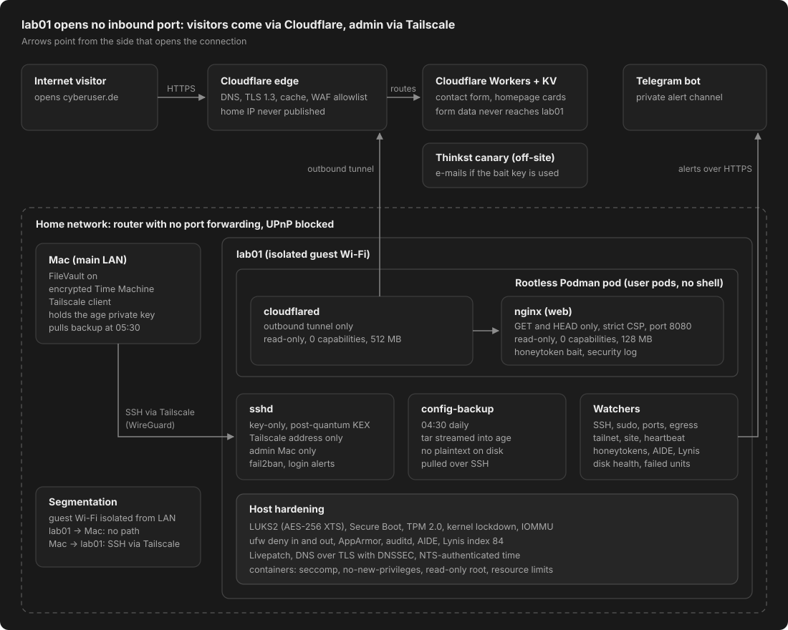

# On-Premises Defense-in-Depth Web Infrastructure

**A self-built, single-host Linux server that publishes a public website with zero open inbound ports, runs every workload rootless and unprivileged, encrypts everything at rest and in transit, and detects, attributes and reports real attacks.**

---

lab01 is a single laptop server in a private home that serves the public site [cyberuser.de](https://cyberuser.de). The site currently offers two features: a security situation page listing current CVEs from official sources, rendered at the edge by a Cloudflare Worker, and a browser fingerprinting page that shows visitors what their own browser reveals, computed entirely in the browser. Further features are planned. It follows a **zero inbound exposure** model: visitors are served by Cloudflare, which reaches the server only through a tunnel the server itself opens outwards, and the administrator connects only through an encrypted private network from one approved device.

The public payload is a static site. The engineering is in the architecture, the hardening, the encryption and the day-to-day operation around it, including a full detection pipeline that has already caught live credential theft and one of its own blind spots.

> [!NOTE]
> This is a self-assessment by the system owner, built and verified against CIS and NIST controls. It shows alignment, not certification. Addresses, key fingerprints, tunnel IDs, WAF rule identifiers and account names belonging to this environment are redacted. Attacker source addresses are published as indicators.

## Contents

- [At a glance](#at-a-glance)
- [Architecture](#architecture)
- [Security design principles](#security-design-principles)
- [Security posture by area](#security-posture-by-area)
- [Encryption](#encryption)
- [Host and platform](#host-and-platform)
- [Network](#network)
- [Identity and access](#identity-and-access)
- [Workloads](#workloads)
- [Edge and web application](#edge-and-web-application)
- [Detection and monitoring](#detection-and-monitoring)
- [Backup and recovery](#backup-and-recovery)
- [Audit and remediation](#audit-and-remediation)
- [External validation](#external-validation)
- [Incident: observed credential pipeline](#incident-observed-credential-pipeline)
- [Incident: security log blindness](#incident-security-log-blindness)
- [Operations log](#operations-log)
- [Threat intelligence](#threat-intelligence)
- [Privacy and legal](#privacy-and-legal)
- [Standards and frameworks](#standards-and-frameworks)
- [Residual risks and accepted trade-offs](#residual-risks-and-accepted-trade-offs)
- [Lessons learned](#lessons-learned)
- [What this demonstrates](#what-this-demonstrates)

## At a glance

| | Key figure | What it means |
| --- | --- | --- |
| 🌐 | **0 inbound ports** | Nothing on the home connection is reachable from the internet |
| 🛠️ | **20 of 21 findings fixed** | The one remaining item is vendor firmware without an available update |
| 🧱 | **Lynis hardening index 84** | Up from a baseline of 71, zero warnings, audited automatically every day |
| ✅ | **internet.nl 100% / 100%** | Website and e-mail security test of the domain |
| 🔐 | **Encryption everywhere** | Disk, network traffic, DNS, time, backups and backup media |
| 🔔 | **Real-time alerting** | Logins, new ports, file changes, failed services, blocked egress and disk health reported instantly |
| 📡 | **Self-checking detection** | An hourly live probe proves the security sensor is still recording; if it stops, an alert is sent instead of a quiet all-clear |
| 🪤 | **Deception tripwires that fired** | First hits on 18 November 2026: 2 requests admitted by design, 1,680 refused at the edge in the same window |

> [!IMPORTANT]
> **Overall assessment: strong security posture for a single-host environment.** The server cannot be reached from the internet, administration requires an approved device plus a key, every workload runs without privileges, all data is encrypted at rest and in transit, and every relevant event triggers an alert. The remaining risks are documented, owner-accepted and mostly outside the owner's control (vendor firmware, single physical host).

## Architecture

Arrows point from the side that opens the connection. Every arrow that leaves the home network is outbound: nothing on the internet can open a connection to the server.

**How a visitor reaches the site**

1. The visitor's browser connects to Cloudflare. The home IP address is never published in DNS.
2. Cloudflare checks the request (TLS 1.3 only, WAF allowlist, bot protection, rate limiting) and answers from its cache when it can.
3. Contact form submissions and the dynamic homepage cards are handled at Cloudflare by Workers. Form data never reaches the home server.
4. Everything else travels through a Cloudflare Tunnel that `cloudflared` on lab01 opens outwards, to nginx in the same rootless pod. The router has no open port.

**How the administrator reaches the server.** Only through Tailscale (WireGuard), only from one approved device on the main LAN, only to the SSH service, and only with a key. The tailnet policy is one-way, so the server cannot open connections back to the admin device. lab01 itself sits on the router's guest Wi-Fi, isolated from the home network.

**How backups leave the server.** A daily job at 04:30 streams the configuration straight into `age` encryption. The admin Mac pulls the encrypted archive over SSH at 05:30 and holds the only private key: the server can write its backups but cannot decrypt them.

**How alerts leave the server.** Every watcher reports to a private Telegram bot over outbound HTTPS. The off-site Thinkst canary reports by e-mail, independently of the server.

| Flow | Opened by | Transport | Protection |
| --- | --- | --- | --- |
| Visitor to site | Visitor | HTTPS to Cloudflare | TLS 1.3 only, hybrid ML-KEM key exchange, HSTS |
| Edge to origin | lab01 (outbound) | Cloudflare Tunnel | Encrypted tunnel, origin certificate validated (Full strict) |
| Contact form | Visitor | HTTPS to a Worker | Terminates at the edge, never reaches lab01 |
| Administration | Admin Mac | Tailscale (WireGuard), then SSH | Two encrypted layers, key-only, post-quantum hybrid SSH key exchange |
| Backup | Admin Mac (pull) | SSH over Tailscale | Archive already `age`-encrypted on the server |
| Alerts | lab01 (outbound) | HTTPS to Telegram | TLS, content minimised |

## Security design principles

| Principle | How it is implemented |
| --- | --- |
| **Zero inbound exposure** | No port forwarding, no public IP in DNS; the website is reached through an outbound tunnel, the admin access through a private network |
| **Zero trust administration** | Access is granted per device and per service: one approved device, one port, key-only login, no access in the opposite direction |
| **Defense in depth** | Every layer assumes the one before can fail: edge protection, firewall in both directions, isolated containers, hardened host, encrypted disk |
| **Least privilege** | Containers run without root and without any capabilities; the service account has no shell; privileged tools are limited to one admin |
| **Encryption everywhere** | Full-disk encryption at rest, TLS 1.3 and WireGuard in transit, encrypted DNS and time, encrypted backups and backup media |
| **Detect, alert, recover** | Integrity monitoring, audit logging and custom watchers alert in real time; services restart themselves; encrypted backups are kept off the server |

## Security posture by area

| Area | Rating | Summary |
| --- | --- | --- |
| Perimeter and network | 🟢 Strong | No inbound ports; firewall denies by default in both directions, IPv6 included; encrypted DNS |
| Identity and access | 🟢 Strong | Key-only SSH on the private network only; account lockout and password policy; passkeys on all cloud accounts |
| Operating system | 🟢 Strong | Automatic security updates and live kernel patching; kernel and boot hardening; unused components removed |
| Workloads | 🟢 Strong | Rootless containers with zero privileges, read-only filesystems, resource limits and self-healing |
| Website and edge | 🟢 Strong | Strict browser security policy, TLS 1.3 only, allowlist WAF, bot and abuse protection, privacy-friendly contact form |
| Data protection and backup | 🟢 Strong | Encryption at rest and in transit; daily encrypted off-server backups with tested restore; key escrow |
| Monitoring and detection | 🟢 Strong | File integrity, audit logging, port, network, login, disk and certificate monitoring, liveness-checked, with instant alerts |
| Outbound traffic control | 🟡 Good | Strict allowlist, except web traffic (HTTPS), which stays open for updates and is the main residual risk |
| Firmware and physical | 🟡 Good | Secure Boot, TPM 2.0 and flash protection active; one vendor firmware component without an available update |
| Availability | 🟡 Adequate | Single physical server on Wi-Fi; outages are detected and alerted, no redundancy by design |

## Encryption

Every place data rests or moves is encrypted, and every key has a defined home and a recovery copy.

### At rest

| Asset | Implementation |
| --- | --- |
| Server disk | LUKS2, `aes-xts-plain64`, 512-bit key (AES-256 XTS), LVM inside the encrypted container |
| Unlock | Passphrase at boot, entered at the console. No unattended unlock, so a stolen or powered-off server reveals nothing |
| LUKS header backup | Encrypted with `age` under a passphrase kept in the password manager; the plaintext copy was removed |
| Server backups | `tar` streams directly into `age`: no plaintext archive ever touches the disk. SHA-256 checksum stored next to each archive |
| Backup decryption key | Held only by the admin Mac, with an escrow copy in the password manager. The server cannot decrypt its own backups |
| Admin workstation | FileVault full-disk encryption |
| Workstation backup | Time Machine to a dedicated encrypted volume on an encrypted external SSD (APFS, encrypted in place) |
| Local passwords | `yescrypt` hashes |
| Application secrets | Telegram bot token and chat ID stored as encrypted Cloudflare Worker secrets |
| Tunnel credentials | Mode `400`, owned by the container's mapped UID, inside a `700` directory: not even the service user can read them |

### In transit

| Path | Implementation |
| --- | --- |
| Visitor to edge | TLS 1.3 only (TLS 1.2 handshakes refused); key exchange offered only with hybrid **ML-KEM** groups (post-quantum, as recommended by NIST for the transition period); 3 cipher suites |
| Edge certificates | Cloudflare Universal SSL, ECDSA P-256, apex and wildcard; active certificate from Let's Encrypt plus a backup from a second CA |
| HTTPS enforcement | HSTS `max-age=31536000; includeSubDomains`, Always Use HTTPS, redirects upgrade on the same host first |
| Edge to origin | Cloudflare Tunnel opened outwards by lab01; SSL mode **Full (strict)**, pinned manually with automatic mode disabled |
| Administration | Tailscale (WireGuard) as the outer layer, SSH inside it |
| SSH key exchange | Post-quantum hybrid first: `mlkem768x25519-sha256`, `sntrup761x25519-sha512`; Ed25519 keys |
| DNS resolution | `systemd-resolved` with DNS over TLS to Quad9 and DNSSEC validation |
| Domain DNS | DNSSEC signed, DS record algorithm 13 (ECDSA P-256), SHA-256 digest, validated |
| Time | `chrony` with NTS (authenticated NTP) against Ubuntu's NTS servers |
| Alerts | HTTPS to Telegram, with content minimised (no IP addresses in reports, no message content in form notifications) |
| Local Wi-Fi | WPA2 with protected management frames and 20-character random keys (WPA3 not offered by the router firmware) |

## Host and platform

| Control | State |
| --- | --- |
| Hardware | Lenovo IdeaPad 3 17ITL6 (i5-1135G7), firmware GGCN61WW (latest official) |
| Secure Boot | Enabled |
| Platform security | TPM 2.0, kernel lockdown, IOMMU with pre-boot DMA protection, SPI flash locked, Intel BootGuard enabled |
| CPU microcode | Loaded early from the initramfs; every CPU vulnerability reported as mitigated or not affected |
| `/boot` | Mounted `nodev,nosuid`; kernel images and `grub.cfg` readable by root only |
| EFI system partition | Mounted `umask=0077,nodev,nosuid,noexec` (root only) |
| NVMe health | SMART `PASSED`, 0 media errors, 12% wear, monitored continuously by `smartd` |
| OS / kernel | Ubuntu 26.04.1 LTS, Linux 7.0 |
| Automatic updates | `unattended-upgrades` for `-security`, ESM Apps and ESM Infra (Ubuntu Pro) |
| Kernel live patching | Canonical Livepatch, kernel supported until 2027-11-23 |
| Mandatory access control | AppArmor loaded, 121 profiles in enforce mode |
| `/tmp`, `/dev/shm` | tmpfs, `nosuid,nodev,noexec` and `nosuid,nodev` |
| Crash reporting | apport and kdump removed; core dumps disabled everywhere (`DefaultLimitCORE=0`, `fs.suid_dumpable=0`) |
| Package minimisation | Tor, pipx, kdump stack, open-vm-tools, apport, landscape-common and orphaned dependencies removed |
| Kernel modules | Bluetooth, sound, camera, KVM, uncommon filesystems and protocols (DCCP, SCTP, RDS, TIPC) blocked with `install /bin/false` |
| SUID reduction | SUID removed where not needed; `newuidmap` / `newgidmap` limited to the container service group |
| Failed units | 0 |

<b>Kernel hardening parameters</b>

| Parameter | Value | Effect |
| --- | --- | --- |
| `net.ipv4.ip_forward` | 0 | Host does not route traffic |
| `net.ipv4.conf.all.rp_filter` | 1 | Strict reverse path filtering (anti-spoofing) |
| `net.ipv4.tcp_syncookies` | 1 | SYN flood protection |
| `net.ipv4.conf.all.accept_redirects` | 0 | Ignores ICMP redirects |
| `kernel.kptr_restrict` | 2 | Kernel pointers hidden |
| `kernel.dmesg_restrict` | 1 | Kernel log restricted to root |
| `kernel.unprivileged_bpf_disabled` | 1 | No unprivileged eBPF |
| `kernel.yama.ptrace_scope` | 1 | Restricted ptrace |
| `net.core.bpf_jit_harden` | 2 | Hardened eBPF JIT |
| `kernel.randomize_va_space` | 2 | Full ASLR |
| `fs.suid_dumpable` | 0 | No core dumps from privileged processes |
| `fs.protected_fifos`, `fs.protected_regular` | 2 | No spoofed files or FIFOs in sticky directories |
| Boot parameter `gather_data_sampling` | force | Downfall (CVE-2022-40982) microcode mitigation enforced; the distribution kernel ships with it disabled |

## Network

**Firewall (UFW):** `deny (incoming)`, `deny (outgoing)`, `disabled (routed)`. Every allow rule carries a comment explaining its purpose.

| Direction | Allowed | Purpose |
| --- | --- | --- |
| In | 22/tcp on `tailscale0`, from the admin Mac only | SSH administration |
| Out | any on `tailscale0` | Tailnet traffic, governed by Tailscale ACLs |
| Out | 853/tcp to Quad9 only | DNS over TLS |
| Out | 80/tcp, 443/tcp | APT (signed packages), ESM, Livepatch, Telegram, Tailscale control and DERP |
| Out | 7844 tcp/udp to Cloudflare tunnel ranges only | Cloudflare Tunnel |
| Out | 41641/udp, 3478/udp | WireGuard, STUN |
| Out | 123/udp, 4460/tcp | NTP with NTS key exchange |
| Out | 67/udp | DHCP |
| Out (deny) | 5351/udp, 1900/udp, SSDP multicast | UPnP and NAT-PMP intentionally blocked |

- **Listening services:** TCP only `sshd` (bound to the Tailscale address) and `tailscaled`. UDP only the local resolver, DHCP client, chrony on loopback and WireGuard. Tailscale Serve and Funnel are not configured.
- **DNS:** Quad9 over DNS over TLS with DNSSEC validation. MagicDNS is scoped to tailnet names only, so general queries never leave through it.
- **Home network:** the server sits on the router's guest Wi-Fi, limited to internet access and isolated from the home network. Router firmware current with automatic updates, WPA2 with protected management frames, WPS off, no port forwardings, ISP remote configuration off, botnet detection on.

## Identity and access

| Control | State |
| --- | --- |
| SSH listener | Bound only to the Tailscale address (`ssh.socket` drop-in with `FreeBind`): unreachable on the Wi-Fi interface even if the firewall were down |
| SSH authentication | Public key only; password and keyboard-interactive disabled |
| Root login | Disabled; root has no authorized keys |
| Allowed users | One admin account |
| Brute force limits | `maxauthtries 3`, fail2ban `sshd` jail (3 attempts, 1 h ban, admin device whitelisted) |
| Forwarding | TCP, agent, X11 and tunnel forwarding disabled |
| Keys | 2 × Ed25519: admin key, plus a backup key restricted by source address, `restrict` and a forced command |
| Shell accounts | root and one admin user; the service account `pods` has no shell and is locked |
| sudo | One admin user (sudo-rs), no `NOPASSWD`, `use_pty` |
| Password policy | `pam_pwquality`: minimum 14 characters, 3 character classes, dictionary check, enforced for root; `nullok` removed through a custom `pam-auth-update` profile that survives package updates |
| Account lockout | `pam_faillock`: 5 failures within 15 minutes lock the account for 15 minutes (counting and reset tested) |
| Login visibility | PAM hook sends a Telegram alert on every SSH login; sudo and su watched in real time |
| Tailnet policy | One rule: admin Mac to lab01 on TCP 22. No rule in the opposite direction |
| Tailnet membership | Device approval required, node key expiry 180 days, identity provider protected by a passkey |
| Cloud accounts | Passkeys on Cloudflare and the identity provider, 2FA on the registrar; one scoped API token in use (CI deployment, expires November 2027, rotation reminder scheduled) |

## Workloads

Containers run under **rootless Podman** as a dedicated, shell-less service user, defined as systemd Quadlets and grouped in one pod. Lingering is enabled so the pod starts at boot without a login.

| Setting | cloudflared | web (nginx) |
| --- | --- | --- |
| Image | `cloudflare/cloudflared`, pinned version | `nginx/nginx-unprivileged`, Alpine, digest verified |
| Runtime user | 65532 (non-root) | 101 (non-root) |
| Root filesystem | read-only | read-only |
| Capabilities | all dropped | all dropped |
| `no-new-privileges` | yes | yes |
| Memory / PID limits | 512 MB / 100 | 128 MB / 100 |
| Published host ports | none | none |
| Effective capabilities / seccomp | 0 / filter (verified in `/proc`) | 0 / filter (verified in `/proc`) |
| Healthcheck | `cloudflared tunnel ready` (checks the live edge connection) | `wget` on `localhost:8080` |
| On failure | killed and restarted by systemd | killed and restarted by systemd |

- **Supply chain:** `image-watch` runs weekly and reports rebuilt tags (digest drift), new upstream versions and tags that disappeared. Images are updated deliberately, never automatically. A per-user image policy rejects every image except the two repositories in use (tested).
- **Tunnel:** locally managed configuration with one ingress rule to `localhost:8080` and a catch-all `http_status:404`. The metrics endpoint used by the healthcheck listens only on the pod's loopback interface.

## Edge and web application

<b>HTTP security headers (verified on the live site)</b>

| Header | Value |
| --- | --- |
| Content-Security-Policy | `default-src 'none'; script-src 'self'; style-src 'self'; img-src 'self'; font-src 'self'; connect-src 'none'; base-uri 'none'; form-action 'self'; frame-ancestors 'none'` |
| Strict-Transport-Security | `max-age=31536000; includeSubDomains` |
| Cross-Origin-Embedder-Policy | `require-corp` |
| Cross-Origin-Opener-Policy | `same-origin` |
| Cross-Origin-Resource-Policy | `same-origin` |
| Referrer-Policy | `no-referrer` |
| Permissions-Policy | `camera=(), microphone=(), geolocation=(), payment=(), usb=()` |
| X-Content-Type-Options | `nosniff` |
| X-Frame-Options | `DENY` |

- **Front end:** no inline scripts or styles, no third-party origins at all, cross-origin isolated (COOP + COEP). The fingerprinting page runs entirely in the browser; `connect-src 'none'` guarantees the page cannot send client data anywhere. Lighthouse Performance, Accessibility, Best Practices and SEO all at 100 on mobile and desktop.
- **Contact form:** handled by a Cloudflare Worker on one exact route. Other methods receive `405` with `Allow: POST`. Only same-origin, URL-encoded POST requests are accepted (`Sec-Fetch-Site` check against CSRF), sizes are capped, honeypot submissions are dropped silently, messages are stored in Workers KV with a 90-day expiry, and the Telegram notification carries no content, so no personal data leaves Cloudflare. A rate limit blocks more than 2 requests in 10 seconds (tested: `405, 405, 429, 429`).
- **Caching:** browser cache per asset type through an nginx `map` (static CSS and JS `max-age=31536000, immutable`, HTML `max-age=300`), chosen over a `location` block so all security headers still apply to every response.

| Domain and edge control | State |
| --- | --- |
| DNSSEC | DS record, algorithm 13 (ECDSA P-256), SHA-256 digest, validated |
| CAA | One owner record; Cloudflare's auto-managed RRset supersedes it (CVE-2026-14440). Kept on purpose, see the [14 November review](#14-november-credential-dns-and-certificate-review) |
| E-mail posture | No-mail domain: Null MX, SPF `-all` on the apex and as wildcard, DMARC `reject` with strict alignment, revoked DKIM |
| security.txt | Published (RFC 9116), checked daily for expiry |
| Edge TLS | Full (strict), pinned; minimum TLS 1.3; HSTS 12 months including subdomains; hybrid ML-KEM key exchange |
| Certificate Transparency | E-mail alert for every certificate issued for the domain, verified against two independent CT indexes |
| Bot protection | Bot Fight Mode and the managed ruleset active; site monitor verified unaffected |
| Non-standard ports | WAF rule blocks every request not received on port 80 or 443, closing Cloudflare's alternative HTTPS ports after scanner probes on 2053 |
| Request allowlist | WAF rule that refuses every path the site does not actually serve. The full path list, the three Worker routes and the probes that depend on it are kept on the host and verified by a 34-probe regression test |
| AI crawlers | Training crawlers blocked; search crawlers and user-initiated agents allowed; mirrored into `robots.txt` |

## Detection and monitoring

| Component | Trigger | Purpose |
| --- | --- | --- |
| port-watch | timer, minutes | Alerts on new listening ports |
| site-watch | timer, minutes | Two independent probes: `SITE` exercises the edge and homepage Worker; `ORIGIN` forces a cache miss so it must reach nginx through the tunnel |
| tailnet-watch | timer, ~15 min | New or changed devices in the tailnet |
| egress-watch | continuous | Alerts on blocked outgoing connections |
| sudo-watch | continuous | Suspicious sudo / su activity |
| ssh-login-alert | PAM, every login | SSH login notification |
| AIDE | daily | File integrity monitoring; every accepted baseline is archived and hash-logged for later audit |
| Lynis | daily | Hardening audit |
| image-watch | weekly | Container image drift and updates |
| securitytxt-check | daily | security.txt validity |
| smartd | continuous, weekly self-test | NVMe health, failed self-tests, temperature above 70 °C |
| auditd | continuous | 66 kernel audit rules |
| acct, sysstat | continuous | Process accounting and performance history |
| Certificate Transparency | every new certificate | E-mail alert from Cloudflare |
| nginx security log | every blocked or suspicious request | JSON log with visitor IP and country, kept 7 days; normal visits are not logged |
| attack-report | daily | Telegram summary without IP addresses; states explicitly that it counts origin-side traffic only |
| attack-alert | every 15 minutes | Immediate alert if an attack pattern is answered with success, or on a server error |
| seclog-heartbeat | hourly | Sends a probe through the full public path and proves it is recorded; alerts after two consecutive failures |
| honeytoken-watch | continuous | Instant alert when a bait path is requested, with source IP, country and user agent |
| allowlist-test | manual | 34-probe regression test of the edge allowlist; tells an edge block from an origin answer by response size |
| Login status screen | every SSH login | Load, temperatures, disk, NVMe wear and OK / PROBLEM checks across the stack |

All custom watchers run sandboxed (systemd exposure 2.0 to 2.6). Thirteen units, including ssh, tailscaled, auditd, fail2ban, AIDE and backup, raise a Telegram alert through `notify-failure@` when they fail. The journal is persistent.

## Backup and recovery

| Control | State |
| --- | --- |
| Scope | `/etc`, `/usr/local`, `/root`, watcher state, website content, tunnel configuration, container Quadlets |
| Encryption | `tar` streams directly into `age`; no plaintext archive touches the disk |
| Integrity | SHA-256 checksum next to each archive |
| Schedule | Daily timer |
| Off-host copy | Pulled by the admin Mac over Tailscale with a dedicated key (source-restricted, forced command); only `age`-encrypted files are accepted |
| Decryption key | On the admin Mac, plus an escrow copy in the password manager |
| LUKS header backup | `age`-encrypted, passphrase in the password manager |
| Admin workstation | Time Machine to an encrypted volume on an encrypted external SSD |
| Change safety | LVM snapshot immediately before a risky change, removed afterwards (a standing snapshot grows with every write and is invalidated once full) |

**Admin workstation (macOS):** FileVault, SIP, Gatekeeper, firewall in stealth mode, Remote Login off, automatic security updates, no leftover privileged helpers of removed applications.

## Audit and remediation

On 10 November 2026 the whole environment was audited: server, edge, admin network, router and admin workstation. Method: configuration review and live verification aligned with CIS controls, Lynis, AIDE, external tests of TLS, headers, methods and sensitive paths, and non-destructive probes from the internet and the LAN. Remediation was applied one change at a time, each verified before the next, with an LVM snapshot as rollback point.

Severity combines likelihood and impact in this specific environment, following NIST SP 800-30, rather than raw CVSS base scores.

| Severity | Findings | Fixed | Accepted |
| --- | --- | --- | --- |
| 🔴 Critical | 0 | 0 | 0 |
| 🔴 High | 1 | 1 | 0 |
| 🟠 Medium | 5 | 4 | 1 |
| 🟡 Low | 14 | 14 | 0 |
| ⚪ Info | 1 | 1 | 0 |
| **Total** | **21** | **20** | **1** |

**Most important improvements**

- **CPU data-leak protection enabled:** the Downfall mitigation (CVE-2022-40982) was disabled in the distribution kernel and is now enforced.
- **Brute-force protection for local logins:** accounts lock after repeated wrong passwords; empty passwords are no longer accepted.
- **Backups made recoverable and private:** the decryption key now has a second copy, leftover unencrypted archives were removed, and the admin workstation has encrypted backups again.
- **Smaller attack surface:** SSH listens only on the private network, unused software and modules were removed, the container platform accepts only approved images.
- **Stronger edge:** strict certificate validation, rate limiting on the contact form, bot protection, removal of unused API tokens.

<b>All 21 findings</b>

| ID | Severity | Finding | Status |
| --- | --- | --- | --- |
| F-01 | **High** | Downfall (CVE-2022-40982) reported as vulnerable: kernel built without `CONFIG_MITIGATION_GDS` | Fixed: `gather_data_sampling=force`, now "Mitigation: Microcode", AVX2 kept |
| F-02 | Medium | Admin workstation without working Time Machine backup; external SSD stored personal data unencrypted | Fixed: SSD encrypted in place, new encrypted Time Machine volume |
| F-03 | Medium | Backup decryption key existed in a single copy | Fixed: escrow copy in the password manager |
| F-04 | Medium | Plaintext config archives and an unencrypted LUKS header backup on the admin Mac, also in local snapshots | Fixed: plaintext removed, header encrypted with `age`, snapshots deleted |
| F-05 | Medium | No account lockout for local passwords | Fixed: `pam_faillock` |
| F-06 | Medium | Intel CSME firmware flagged as vulnerable, no update published on LVFS | Accepted: latest official BIOS installed; unofficial patched firmware rejected (would require disabling flash protection and Secure Boot) |
| F-07 | Low | Cloudflare SSL mode "Full": origin certificate not validated | Fixed: Full (strict) |
| F-08 | Low | No rate limiting for the contact form | Fixed and tested |
| F-09 | Low | Two unused Cloudflare API tokens left by the tunnel login | Fixed: both revoked, tunnel verified healthy |
| F-10 | Low | `ssh.socket` listened on all interfaces | Fixed: bound to the Tailscale address |
| F-11 | Low | `nullok` in `pam_unix`, no password quality policy | Fixed |
| F-12 | Low | EFI partition world-readable; `/boot` without `nodev,nosuid` | Fixed |
| F-13 | Low | Hard core dump limit "unlimited" | Fixed |
| F-14 | Low | Unused packages and a leftover service account with inherited stale files | Fixed |
| F-15 | Low | Tunnel credentials file mode `644` | Fixed: `400`, owned by the container UID |
| F-16 | Low | Container image policy accepted any image | Fixed: default reject, two repositories allowed |
| F-17 | Low | No disk health monitoring | Fixed: `smartd` with Telegram alerts |
| F-18 | Low | `cloudflared` without healthcheck | Fixed: `cloudflared tunnel ready` |
| F-19 | Low | KVM modules loaded but unused | Fixed: blocked |
| F-20 | Low | Admin workstation: privileged helpers left by uninstalled apps; files owned by a non-existent UID | Fixed |
| F-21 | Info | Certificate Transparency monitoring not enabled | Fixed |

**Methodology note:** SPF and DMARC first appeared to be missing because the queries went through a VPN resolver that timed out. The authoritative name servers showed both records present. Negative DNS results are now always confirmed against the authoritative server.

## External validation

On 11 November 2026 the public endpoint was tested with independent scanners. They reach the Cloudflare edge, not lab01, so they assess the edge and web configuration; host hardening is covered by Lynis and the audit.

| Scanner | Result | Notes |
| --- | --- | --- |
| **internet.nl** | 🟢 100% website, 100% e-mail | DNSSEC, TLS, IPv6, headers, e-mail posture |
| **ImmuniWeb SSL** | 🟢 Grade A | TLS 1.3 only; hybrid ML-KEM key exchange; 3 cipher suites, all PCI DSS and GDPR compliant |
| **Censys** | 🟢 Certificates only, no exposed host or service | Two certificates, apex and wildcard, both via Universal SSL |
| **Hardenize** | 🟡 Findings not reproducible | Redirect, HSTS and CSP flags all verified correct by hand; HSTS preload intentionally unused |
| **Legacy TLS scanner** | ⚪ "TLS not supported" | Cannot negotiate TLS 1.3, which is the only version offered. Not a finding |

<b>Manual verification and assessment of scanner remarks</b>

| Check | Observed |
| --- | --- |
| `http://cyberuser.de` | `301` to `https://cyberuser.de/` |
| `http://www.cyberuser.de` | `301` to `https://www.cyberuser.de/` |
| `https://www.cyberuser.de` | `301` to `https://cyberuser.de/`, with HSTS sent on this intermediate hop |
| `https://cyberuser.de` | HSTS and the strict CSP |
| TLS 1.2 handshake | Refused (curl exit code 35), confirming TLS 1.3 only |

| Remark | Assessment |
| --- | --- |
| HIPAA compliance failed | Not applicable (US health regulation); the suite in question is ChaCha20-Poly1305, considered strong |
| No OCSP responder URL | Expected: Let's Encrypt no longer operates OCSP; revocation via CRLs |
| Classical certificate signatures only | Expected: no publicly trusted post-quantum certificates exist yet; the key exchange already is post-quantum |
| No server cipher preference | No risk: all three TLS 1.3 suites are strong |
| Client-initiated renegotiation | False positive: TLS 1.3 has no renegotiation |

## Incident: observed credential pipeline

> [!TIP]
> **Summary.** A planted `.env` was stolen twice within three hours of deployment, and the AWS canary key inside it was used against AWS within twenty minutes, from a different network than the one that stole it. No access was obtained and no data was affected. The incident was attributed across two networks and the indicators were reported to abuse.ch ThreatFox.

**Setup.** On 17 November 2026 two bait paths were planted, deliberately allowed through the edge allowlist and served only to be recorded:

| Stage | Bait | What a hit proves |
| --- | --- | --- |
| 1 | A planted `/.env`, served by an exact-match nginx location that overrides the dotfile deny | A scanner grabbed the file and holds its (fake) contents |
| 2 | A fake backup URL that exists only inside that `.env`, at an unguessable path | The attacker read the stolen file and acted on it |
| Off-site | A Thinkst canary AWS key in the same file, monitored by a third party | The stolen key was used, and from where |

Every hit is malicious by construction: no legitimate visitor requests a planted `.env` or a URL that appears nowhere on the site. The allowlist removes the surrounding noise, so the one deliberately open path becomes a zero-false-positive signal.

**Timeline, 18 November 2026 (UTC)**

| Time | Source | Tooling | Event | Result |
| --- | --- | --- | --- | --- |
| 00:42 | 185.218.86.27 | spoofed browser UA, Chrome 126 | `GET /.env` (Stage 1) | `200`, admitted by design |
| 01:02 | 185.218.86.27 | Go-http-client/1.1 | `GetCallerIdentity` | AccessDenied |
| 01:07 | 93.123.109.177 | Boto3 1.43.96, Python 3.12.3 | `GetSendQuota` | AccessDenied |
| 01:09 | 93.123.109.177 | Boto3 | `GetSendQuota` | AccessDenied |
| 01:12 | 93.123.109.177 | Boto3 | `GetCallerIdentity` | AccessDenied |
| 01:15 | 185.218.86.27 | not recorded | four path probes | Blocked at the edge |
| 01:19 to 01:24 | 93.123.109.177 | Boto3 | `GetSendQuota`, repeating | AccessDenied |
| 01:28 | 45.138.12.217 | spoofed browser UA, Chrome 147 | `GET /.env` (Stage 1) | `200`, admitted by design |
| 01:29 | 185.218.86.26 | spoofed browser UA, Chrome 126 | about 20 probes in two seconds | Blocked at the edge |

By midday the canary had produced 126 notifications, every one answered `AccessDenied`. In the same window the edge allowlist refused **1,680 requests and admitted 2**, both baits. The refused paths covered three exposure families (dotenv files, Git repositories, Spring Boot Actuator endpoints), plus WordPress fingerprinting from an IPv6 address: the rule matches on the path, so it is indifferent to address family.

**Three roles, two networks.** `GetCallerIdentity` answers whether the key is alive; `GetSendQuota` answers whether it can send mail, and is region-scoped, which is why it repeats: harvested AWS keys are monetised primarily as SES relays. The canary key authenticates but authorises nothing, so every call returns `AccessDenied` rather than an invalid-credential error, and the enumeration keeps going.

| | Harvesting: 185.218.86.26, .27, 45.138.12.217 | Exploitation: 93.123.109.177 |
| --- | --- | --- |
| ASN | AS218785, TC DATACENTER LIMITED | AS48090, TECHOFF_SRV_LIMITED (DMZHOST) |
| Allocated | 2 September 2026 | announced since 2023 |
| Registered | Hong Kong | Andorra, described as GB |
| Observed location | Netherlands | Netherlands |
| Transit | AS202425, IP Volume | not established |

The two consecutive addresses present the same spoofed user agent (one tool run from two addresses); the third presents a different one (a different tool). None of the web-facing requests admits to being automated, yet the same operator's AWS API calls carry an unmodified Go client string, because a user agent is only worth faking where something inspects it. Two addresses were already catalogued in the SANS Internet Storm Center database (one adjacent address at 650 to 790 reports a day in autumn 2026). The split is rational: web-facing work runs from a fresh allocation with no reputation, while key testing runs from address space whose reputation is irrelevant at an AWS API endpoint.

**What the canary added.** 93.123.109.177 never contacted the site and appears in no origin log (verified by search). Its address is knowledge only an off-site canary can produce, because the exploitation stage never touches the victim.

**Design finding: Stage 2 stayed silent.** The fake backup URL was never requested, although the key in the same file was used within ten minutes. The actor does not read the file, it parses it for recognised credential formats and discards the rest. Stage 2 assumed a reader; the observed population is a parser. Planned change: a credential-shaped tripwire instead of a URL, for example a DNS canary as a database host value, which fires on name resolution.

**Allowlist gap observed in production.** At 01:53 the bait-taking address requested `/.well-known/openid-configuration` and reached the origin, because the allowlist carried `/.well-known/` as a prefix rather than as the two exact files on record. The prefix was narrowed the same day; the path now answers `403` from the edge.

## Incident: security log blindness

> [!WARNING]
> **Summary.** For close to 50 hours the security log stopped recording while the site kept serving, and the daily report kept stating "No attack attempts recorded". The report was accurate about its data and wrong about reality.

- **Timeline:** last entry 15 November 2026, 11:13:21 UTC. Nothing on either logging channel until the web container was recreated on 17 November at about 13:45 UTC for an unrelated image update.
- **Trigger:** the last entries are a burst of more than 190 credential and secret scanning requests within two seconds, all refused with `403`. Logging stopped in the same second the burst ended.
- **Detection gap:** the existing sensor check verified that the log file could be opened. It could, throughout. Readability and liveness are different properties, and only the first was being verified.

<b>Causes ruled out</b>

| Hypothesis | Evidence against |
| --- | --- |
| Log rotation | `copytruncate` preserves the inode; no rotation in the window |
| Log buffering | Access log configured without `buffer` or `flush` |
| Memory exhaustion | No OOM event; nginx measured at 10.2 MB of its 134 MB limit and 9 of 100 processes |
| Container restart | conmon PID unchanged; no unit start or stop recorded |
| Journald failure | The journal recorded the later restart correctly |
| Journald rate limiting | No suppressed or dropped message entries |

Two independent output channels stopped at the same instant while the container kept running. The mechanism was not reproduced and remains documented as an accepted unknown.

**Remediation**

| Layer | Change |
| --- | --- |
| Edge | Credential and secret scanning blocked at Cloudflare, later superseded by the full allowlist |
| Origin | `seclog-heartbeat`: an hourly probe through the full public path that must appear in the log; alert after two failures |
| Reporting | Heartbeat traffic excluded from statistics, later rebound so the exclusion requires both user agent and probe path (an exclusion on user agent alone is a log-evasion primitive) |

**Also validated:** during the investigation a routine `whois` from the server was refused by the outbound firewall (TCP/43 is not allowed) and `egress-watch` reported it within seconds, confirming the egress alerting chain on a real, unplanned event.

**Reported:** the scanning activity was reported to the upstream provider through the Google Compute Engine abuse form, classified as an exploit attempt (PHP CGI argument injection), with reverse-DNS evidence of crawler impersonation and a log extract limited to the two reported addresses.

## Operations log

<b>8 to 10 November: launch and first attacks</b>

The site went live on 8 November 2026 and automated scanners started probing it within hours. **671 attack requests were blocked in the first two days**, every one refused with `403`: environment files (`/.env`, `/.env.production`, `/api/.env`, ...) and exposed Git repositories (`/.git/config`, `/.git/HEAD`). Typical automated credential harvesting. Since 10 November a dedicated security log records every blocked or suspicious request, including `404` probes, keeps IP addresses for at most seven days, and feeds a daily report without IP addresses.

<b>13 November: maintenance, integrity workflow, cache policy, pipeline validation</b>

- Security updates applied with a controlled reboot (LUKS passphrase at the console); all services, Quadlets and timers verified healthy, site `200` externally. Ubuntu Pro active with ESM Infra, ESM Apps and Livepatch.
- `aide-accept` now archives the outgoing baseline as a dated, hash-named copy and logs it, so any past acceptance can be audited by diffing old and new databases. Pruning is manual on purpose: a privileged script that deletes baselines could destroy evidence.
- Differentiated cache policy via an nginx `map`; Lighthouse "efficient cache lifetimes" finding dropped from 135 KiB to 44 KiB.
- **Controlled simulation:** ten probes from an off-site address with a dedicated test user agent (sensitive files, path traversal, SQLi, XSS, scanner user agents).

| Layer | Behaviour |
| --- | --- |
| Cloudflare edge | Blocked sensitive-path and scanner-UA probes (`403`), rejected the traversal (`400`) |
| Edge cache | Query-string-only SQLi and XSS served from cache; never reached the origin |
| Origin nginx | Logged the five requests that reached it, all tagged suspicious |
| attack-alert | Correctly silent: it fires only on a successful hit, and none succeeded |

<b id="14-november-credential-dns-and-certificate-review">14 November: credential, DNS and certificate review</b>

- **Credentials:** deprecated Origin CA key unused; Global API key exists but verified unused across the host; no user API tokens; one account token for CI deployment, scoped, expiring November 2027, rotation reminder scheduled for 19 October 2027.
- **CAA is not enforced as configured.** The zone holds one owner record, but a live query returns eleven: Cloudflare injects `issue` and `issuewild` for five CAs whenever Universal SSL is on, and the injected RRset supersedes the owner's (tracked as **CVE-2026-14440**). Evidence in this zone: a backup certificate from a CA never authorised, and wildcards although no `issuewild` was published. **The record is kept**, because deleting it would permit issuance by any CA in the world. Certificate Transparency monitoring is therefore the effective control.
- **CT lookups need two sources:** crt.sh returned nothing for the domain while Cert Spotter returned both certificates correctly. CT checks now use at least two independent indexes.
- **DNS surface:** 9 records, all proxied or address-free; 20 common leak-prone hostnames absent; TXT-only wildcard (so no address can be synthesised); no IP literals in SPF.
- **Historical exposure:** passive DNS shows one hosting address from 2011 and no residential address ever; Wayback content from a previous owner (2001 to 2002); CT discloses apex and wildcard only.
- **DNS traffic attributed:** 19.3k queries in 7 days, the largest single source (about 19%) being internet.nl's own test platform, confirmed against its published ranges.
- **Edge TLS mode pinned** to Full (strict) with automatic mode disabled (applied 15 November).

<b>15 November: Impressum address and public-exposure review</b>

The home address in the legal notice was replaced with a commercial c/o postal address (ladungsfähige Anschrift), keeping the full name as required by § 18 Abs. 1 MStV. A search across the document root confirmed no home address remains; the old version was kept as a dated backup outside the web root and the cache was purged. A review of the public repositories confirmed the address was never committed to Git history.

<b>17 November: allowlist, honeytokens, regression test and documentation</b>

- **Blocklist to allowlist.** A test against the live log found 281 distinct scanner paths still reaching the blocklist, against roughly two dozen valid paths. The edge was inverted: one rule now refuses every path the site does not serve.
- **Self-inflicted blind, caught in minutes.** The new allowlist blocked the heartbeat's own probe; the heartbeat reported the log blind within two checks. Fixed by allowing the probe prefix explicitly.
- **Regression test `allowlist-test`.** Probes every real path, every Worker route and control paths from the public side, and tells an edge block (5,661 bytes) from an nginx block (146 bytes) by response size, since both answer `403`.
- **Gap found: the contact form route was never covered.** WAF rules run before Workers, so a blocked form route would have been invisible on the host: no file, no log, and a silent loss of the only contact channel. Verified reachable and added as a permanent probe.
- **Gap found: the availability monitor was watching the cache.** `site-watch` checked `/`, served from the Cloudflare cache for up to two hours. It now runs a second probe that forces a cache miss and must reach nginx.
- **Documentation as a control.** The live WAF expression was copied verbatim into the host document that governs it. Diffing the two surfaced three undocumented prefixes, including a third Worker route (`/news`) that removal would have broken silently. Test extended to 33, later 34 probes.
- **Process accounting log** moved to the distribution's `ActLog` AIDE macro, so appends are silent while a rewrite of recorded entries is still reported.

<b>18 November: corrections and application-layer testing</b>

- **Exclusion rule rebound:** the report's heartbeat exclusion required only the user agent, which anyone can send. It now requires user agent and probe path together.
- **Report scope stated:** the daily report now says it counts origin-side traffic only, after a day where it counted 4 attempts while the edge refused several hundred.
- **`/.well-known/` prefix narrowed** to its two exact files; a control probe makes a reinstated prefix fail the test (34 of 34 passing).
- **Housekeeping:** standing LVM snapshots removed; recovery rests on the daily encrypted off-host backup.
- **Application-layer testing:** all client-side scripts write output with `textContent` only (no `innerHTML`, no `eval`); the terminal maps input through a static table via `hasOwnProperty.call`, so input is never a navigation target. The contact Worker was exercised live: honeypot, content-free notification, size caps and non-user-controlled storage keys behave as designed, and there is no read route. **No executable injection found.** Two items are recorded rather than fixed: stored values are unescaped (escape at display time if a reader is ever built), and the `Sec-Fetch-Site` gate stops browser CSRF but not scripted submissions, which are bounded by the edge rate limit.

## Threat intelligence

Indicators from the credential-pipeline incident, submitted to **abuse.ch ThreatFox**:

| Indicator | ASN | Role |
| --- | --- | --- |
| `185.218.86.27` | AS218785 | Took the Stage 1 bait at 00:42, then tested the stolen key at 01:02 |
| `185.218.86.26` | AS218785 | Configuration sweep of about 20 paths at 01:29, all refused |
| `45.138.12.217` | AS218785 | Took the Stage 1 bait at 01:28 |
| `93.123.109.177` | AS48090 | Used the stolen key from 01:07 onwards; never contacted the site |

## Privacy and legal

- **GDPR (Art. 5, 13, 21, 25):** the contact form stores no IP addresses, deletes messages after 90 days and notifies without content. The security log keeps IP addresses only for attack requests, for at most 7 days, purpose-limited to defence; reports contain no IP addresses; the right to object is highlighted in the privacy policy. Abuse-case evidence is a documented exception limited to the reported addresses and deleted when the case closes.
- **Impressum (§ 18 Abs. 1 MStV):** name and a summonable c/o address, no home address published.
- **Escalation path documented in advance:** containment and evidence preservation before any rebuild; notification of the supervisory authority within **72 hours under Art. 33 GDPR** if third-party personal data is affected; a criminal complaint under **§ 202a StGB** is prosecuted only on application, within three months, so the deadline is recorded rather than discovered late.
- **Legal basis of the deception:** a passive honeytoken is a collection and attribution control. Taking an openly served bait file does not satisfy § 202a StGB, which requires circumventing an access protection, and no payload or beacon runs on the attacker's side. The canary reports only when the attacker chooses to use a stolen credential against a third-party service.

## Standards and frameworks

| Standard | Applied to | Result |
| --- | --- | --- |
| **CIS Ubuntu Linux Benchmark** | Lockout, password quality, mounts, core dumps, modules, SSH, sudo, integrity, auditing | Relevant controls implemented and tested |
| **Lynis** (CISOfy) | Automated host audit | Index 84 (baseline 71), 0 warnings, daily |
| **NIST CSF 2.0** | Overall security program | All six functions covered |
| **NIST SP 800-207** (Zero Trust) | Administrative access | Per-device, per-service, least privilege |
| **NIST SP 800-30** | Risk rating of findings | Likelihood and impact in this environment |
| **OWASP Secure Headers**, Mozilla Web Security Guidelines | Website | Strict CSP, cross-origin isolation, all recommended headers |
| **internet.nl** | DNSSEC, TLS, IPv6, e-mail | 100% website, 100% e-mail |
| **RFC 6797** HSTS, **RFC 8659** CAA, **RFC 7489** DMARC, **RFC 7505** Null MX, **RFC 9116** security.txt | Domain and web | All implemented |
| **GDPR** Art. 5, 13, 21, 25 | Contact form and security log | Minimisation, retention limits, transparency, privacy by design |

| NIST CSF 2.0 function | Implementation |
| --- | --- |
| Govern | Documented architecture, decisions and accepted risks; every change with a rollback point and verification |
| Identify | Audit of all five components; inventory of services, ports, accounts, containers and probes |
| Protect | Hardened host, isolated workloads, encryption, strict access control, edge allowlist |
| Detect | File integrity, kernel auditing, custom watchers, liveness heartbeat, deception tripwires, CT and disk monitoring |
| Respond | Real-time alerts, automatic banning, abuse reporting, indicator sharing, pre-documented legal escalation |
| Recover | Daily encrypted off-host backups with tested restore, encrypted header backup, key escrow |

## Residual risks and accepted trade-offs

| Risk | Level | Why it is accepted |
| --- | --- | --- |
| Outbound HTTPS open to any destination | 🟡 Medium | Needed for updates and alerts; the main path an intruder could use to send data out. Mitigated by container isolation and integrity monitoring |
| A few root services without a confinement profile | 🟡 Low | No profiles ship from the distribution; the most exposed one updates itself automatically |
| Vendor firmware component without update | 🟡 Low | Latest official firmware installed; exploitation requires prior admin rights or physical access |
| Single physical server | 🟢 Low | Personal lab without availability requirements; outages are detected and alerted |

<b>All accepted trade-offs</b>

| Item | Reason |
| --- | --- |
| Rootless containers without an AppArmor profile | Rootless Podman cannot apply `containers-default`; compensated by zero capabilities, no-new-privileges, seccomp, read-only root and user namespaces |
| Tailscale via DERP relay instead of a direct path | UPnP and NAT-PMP blocked on purpose: slower, but no automatic port openings |
| Device approval instead of Tailnet Lock | Mutually exclusive; the account uses a phishing-resistant passkey |
| Minimum TLS 1.3 at the edge | Very old clients and some scanners cannot connect; acceptable for a security-focused site |
| HSTS without `preload` | Eligible, but preload is no longer recommended, would block future internal subdomains and takes months to undo |
| Router without WPA3 | Not offered by the firmware; WPA2 with PMF and 20-character random keys |
| HTML cached at the edge for 2 h | Free plan minimum; browser cache set per asset type, manual purge after deploys |
| CAA superseded by Cloudflare | Cannot be enforced on this plan; record kept, CT monitoring is the control |
| Mechanism of the 15 November logging failure unidentified | Six causes excluded by evidence; reproducing it would require bypassing the edge and blinding the sensor deliberately. The heartbeat now detects a recurrence within two hours instead of fifty |
| Honeytoken raises scan volume | A bait answering `200` lands in scanner target lists; the extra traffic is refused at the edge and the signal has no false positives |
| Pod infra container without its own memory limit | Podman limits the pod cgroup, not the pause process; both workloads carry their own limits |

## Lessons learned

1. **A monitor that reports silence without proving it can still observe is worse than no monitor.** It turns absence of evidence into evidence of absence. Liveness must be asserted, not assumed.
2. **A blocklist is structurally unwinnable.** 281 scanner paths against two dozen real ones: invert it.
3. **An allowlist converts a mistake from an open door into a silent outage.** The permitted path set becomes a configuration item with a written list and an automated test.
4. **A monitor that can be satisfied by a cache measures the cache.**
5. **Writing the deployed rule into the document that governs it turns the document into a control.** The diff found what the description could not.
6. **An exclusion inside a detector is an evasion primitive** unless it is bound to something the sender cannot choose.
7. **A local tripwire proves a file was taken. Only a tripwire that travels proves it was read, parsed and acted upon,** and it reports from a network the site never sees.
8. **Negative results need a second source,** whether DNS (authoritative server) or Certificate Transparency (two indexes).

## What this demonstrates

| Skill | Evidence in this project |
| --- | --- |
| Secure architecture | Zero-inbound design with an outbound tunnel, isolated guest network, one-way administrative path |
| Linux hardening | CIS-aligned host, Lynis 84, kernel and boot hardening, CPU mitigation fixed beyond the distribution default |
| Container security | Rootless Podman, zero capabilities, read-only, seccomp, image policy, digest-drift monitoring |
| Cryptography in practice | LUKS2, `age` with key separation and escrow, TLS 1.3 with ML-KEM, post-quantum SSH, DNSSEC, DoT, NTS |
| Edge and web security | Allowlist WAF, strict CSP with `default-src 'none'`, internet.nl 100%, rate limiting, serverless form handling |
| Detection engineering | Integrity, audit and custom watchers, liveness heartbeat, regression tests for the edge, deception tripwires |
| Incident response | Two real incidents: root-caused or bounded, remediated, documented, attributed and reported |
| Threat intelligence | Multi-network attribution, ASN and reputation analysis, IOC sharing with ThreatFox |
| Governance and compliance | NIST CSF 2.0 mapping, SP 800-30 risk rating, GDPR minimisation, documented legal escalation |

---

**Author:** Vlad-Răzvan Cozmuța · **Report version:** 2.1 (18 November 2026) · **Next review:** February 2027

