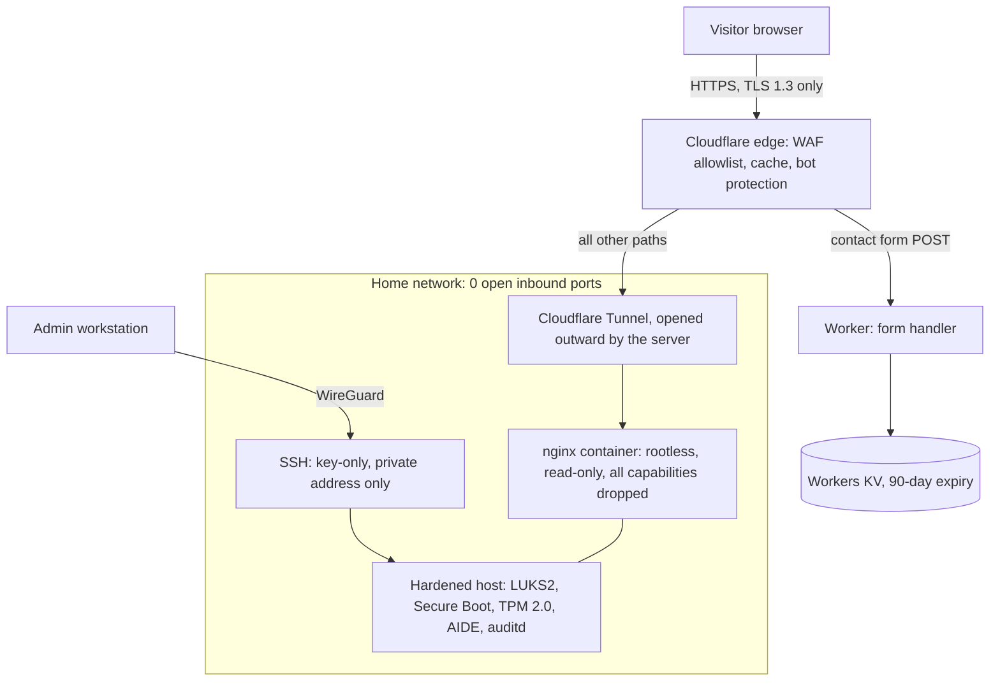

# On-Premises Defense-in-Depth Web Infrastructure

A self-built, single-host Linux server that publishes a public website with **zero open inbound ports**, runs every workload **rootless and unprivileged**, and backs it with a full **detection and incident-response** pipeline.

The public payload is a static site. The engineering is in the architecture, the hardening and the operations around it.

## Overview

| | |
| --- | --- |
| **Platform** | Ubuntu 26.04 LTS on owned hardware, single host, administered over SSH |
| **Exposure** | No inbound ports. Public traffic via Cloudflare and an outbound-only tunnel; administration via WireGuard, key-only |
| **Workloads** | Rootless Podman containers (nginx, cloudflared): zero capabilities, read-only root filesystem, seccomp, resource limits |
| **Assurance** | CIS-aligned hardening (Lynis index 84), file-integrity monitoring, kernel auditing, real-time alerting, daily encrypted off-host backups |
| **Proven in production** | A live credential-harvesting campaign detected, attributed and reported. A 50-hour monitoring blind spot found and closed |

## Architecture

Four properties follow from this shape:

1. The home IP address is never published in DNS. Visitors only ever reach Cloudflare.
2. Contact form submissions are handled entirely at the edge and never reach the server.
3. All other traffic travels a tunnel the server opens outwards, so the router forwards no port.
4. Administration is possible only from one approved device, over WireGuard, to SSH, with a key. The server cannot open connections back.

## Security design principles

| Principle | Implementation |
| --- | --- |
| Zero inbound exposure | No port forwarding, no public IP in DNS; site via outbound tunnel, administration via private network |
| Zero trust administration | Access granted per device and per service; key-only; no reverse path |
| Defense in depth | Every layer assumes the one before it can fail: edge, bidirectional firewall, isolated containers, hardened host, encrypted disk |
| Least privilege | Containers run without root and without capabilities; the service account has no shell |
| Encryption everywhere | LUKS2 at rest; TLS 1.3 and WireGuard in transit; encrypted DNS, backups and backup media |
| Detect, alert, recover | Integrity monitoring, kernel auditing and custom watchers alert in real time; services self-heal; encrypted backups kept off the server |

## Hardening

**Host.** LUKS2 full-disk encryption, Secure Boot, TPM 2.0, kernel lockdown, IOMMU with pre-boot DMA protection. CPU microcode mitigations enforced, including Downfall (CVE-2022-40982), which the distribution kernel ships disabled. Kernel and boot hardening via sysctl, unused modules and packages removed, AppArmor enforcing, unattended security updates and live kernel patching.

**Network.** Firewall default-deny in **both** directions, IPv6 included, with outbound restricted to an explicit allowlist. DNS over TLS with DNSSEC validation. SSH bound to the private interface only, public-key authentication only, post-quantum hybrid key exchange, account lockout and brute-force banning.

**Workloads.** Rootless Podman under a dedicated shell-less service user, defined as systemd units. Containers run read-only with all capabilities dropped, `no-new-privileges`, seccomp filtering, memory and PID limits, health checks and automatic restart. An image policy rejects every image except the two approved repositories.

**Edge and web.** Strict Content-Security-Policy (`default-src 'none'`, no inline script or style, no third-party origins), all recommended security headers, cross-origin isolation, TLS 1.3 only, HSTS, DNSSEC, CAA, and a no-mail DNS posture (Null MX, SPF `-all`, DMARC `reject`). A WAF **allowlist** refuses any path the site does not actually serve, replacing an earlier blocklist that could not keep pace with scanner variety.

## Detection and response

A layered stack alerts in real time: file-integrity monitoring (AIDE), kernel auditing (auditd), and custom watchers for new listening ports, blocked outbound connections, SSH logins, sudo activity, disk health, certificate issuance and site availability. An hourly **heartbeat** proves the security log is still being written, rather than trusting a quiet report.

### Detection in action: an observed credential pipeline

Two bait paths were planted as origin-side tripwires, deliberately allowed through the edge allowlist: a planted `.env` file, and a fake backup URL that exists only inside it. The file contains no real secret. Inside it sits an off-site canary cloud key, monitored by a third party, which reports if it is ever used.

Less than three hours after deployment, both stages met real traffic:

| Time (UTC) | Event | Result |
| --- | --- | --- |
| 00:42 | Planted `.env` taken, spoofed browser user agent | Admitted by design |
| 01:02 | Stolen key tested for liveness, Go client | AccessDenied |
| 01:07 | Stolen key tested for mail-sending quota, Python/boto3, **different network** | AccessDenied |
| 01:28 | Planted `.env` taken by a second host | Admitted by design |
| 01:29 | Configuration sweep, about 20 paths in two seconds | Refused at the edge |

By midday the canary had produced 126 notifications, every one answered `AccessDenied`. In the same window the edge allowlist refused **1,680 requests and admitted two**, both of them baits.

**What the data showed.** The credential did not stay where it was stolen. Harvesting and liveness testing came from one network in Go; exploitation came from a second network in Python, probing mail-sending quota, because harvested cloud keys are monetised primarily as mail relays. The exploitation host never contacted the site and appears in no origin log: its address is knowledge only an off-site canary could produce.

**Indicators, reported to abuse.ch ThreatFox:**

| Address | ASN | Role in the sequence |
| --- | --- | --- |
| 185.218.86.27 | AS218785 | Took the bait, then used the stolen key |
| 45.138.12.217 | AS218785 | Took the bait |
| 185.218.86.26 | AS218785 | Configuration sweep, refused at the edge |
| 93.123.109.177 | AS48090 | Used the stolen key; never contacted the site |

**Design finding.** The second-stage URL was never requested, although the credential in the same file was used within ten minutes. The actor does not read the file, it parses it for recognised credential formats and discards the rest. Stage 2 assumed a reader; the observed population is a parser. The planned correction is a credential-shaped tripwire rather than a URL.

### A monitor that reported silence

Separately, a container update exposed that the security log had silently stopped recording for roughly 50 hours while the daily report kept stating that no attacks had occurred. The report was accurate about its data and wrong about reality. An existing check verified that the log file was readable, but readability and liveness are different properties, and only the first was being asserted.

Six candidate causes (rotation, buffering, memory exhaustion, container restart, journald failure, journald rate limiting) were each excluded by evidence. The mechanism was not reproduced and is documented as an accepted unknown. The remediation does not depend on identifying it: an hourly heartbeat now sends a probe through the full public path and confirms that it appears in the log, alerting after two consecutive failures, and an edge rule removes that traffic class before it reaches the tunnel.

A later finding in the same reporting script showed that its own exclusion filter dropped entries by user agent alone, which is a value the client chooses. That is a log-evasion primitive, and it was rebound to require both the user agent and the probe path together.

**Lessons recorded.** A monitor that reports silence without proving it can still observe turns absence of evidence into evidence of absence. An exclusion inside a detector is an evasion primitive unless it is bound to something the sender cannot choose.

### Handling

Hostile activity was reported to the upstream cloud provider through its abuse process, with evidence limited to the reported source addresses, and indicators were submitted to abuse.ch ThreatFox. The escalation path is documented in advance: containment and evidence preservation before rebuild; notification of the supervisory authority within 72 hours under Art. 33 GDPR where third-party personal data is affected; and the three-month limitation period for a criminal complaint under § 202a StGB recorded rather than discovered late.

The deception itself is a collection and attribution control, not an offensive one. Taking an openly served bait file does not satisfy § 202a StGB, which requires circumventing an access protection, and no payload or beacon runs on the attacker's side.

## Standards and frameworks

Built and checked against recognised standards. This is alignment, not certification.

| Standard | Applied to |
| --- | --- |
| CIS Ubuntu Linux Benchmark | Account lockout, password quality, mount options, kernel modules, SSH, sudo, file integrity, auditing |
| Lynis (CISOfy) | Automated hardening audit: index 84, up from a baseline of 71, zero warnings, runs daily |
| NIST Cybersecurity Framework 2.0 | All six functions covered: Govern, Identify, Protect, Detect, Respond, Recover |
| NIST SP 800-207 (Zero Trust Architecture) | Per-device, per-service, least-privilege administrative access |
| OWASP Secure Headers, Mozilla Web Security Guidelines | Strict CSP, cross-origin isolation, all recommended headers |
| GDPR Art. 5, 13, 21, 25 | Data minimisation on the contact form and the security log; no IP addresses in reports; defined retention |
| internet.nl (Dutch Internet Standards Platform) | 100% website, 100% e-mail |

## Results

| Metric | Value |
| --- | --- |
| Open inbound ports | 0 |
| Audit findings fixed | 20 of 21 (the remaining item is vendor firmware with no published update) |
| Lynis hardening index | 84, from a baseline of 71 |
| internet.nl | 100% website, 100% e-mail |
| Edge requests refused during the honeytoken window | 1,680, with 2 admitted by design |
| Monitoring blind spot | Detected and closed by an asserted liveness check |

## Limitations and accepted risks

Stated plainly, because they are part of an honest assessment:

- **Single physical host on Wi-Fi.** A personal lab with no high-availability requirement. Outages are detected and alerted, not prevented.
- **Self-assessment, not an independent audit.** Point-in-time, by the system owner. No full penetration test of application logic.
- **Outbound HTTPS is open to any destination.** Required for updates and alerting, and therefore the main remaining exfiltration path after a hypothetical compromise. Mitigated by container isolation and file-integrity monitoring.
- **Minimal payload.** The site is static. The strictest results here, `default-src 'none'` and zero inbound exposure, are achievable partly *because* the payload is minimal. A feature-rich application with third-party dependencies would face a materially harder version of the same problem.

## What this demonstrates

Container security (rootless, zero-capability, read-only), attack-surface reduction and zero-trust network design, Linux and edge hardening mapped to CIS and NIST, a detection pipeline that caught its own blind spot, and incident response on live hostile traffic: attribution across two networks, indicator reporting, abuse escalation and correct legal handling.

The payload is a static site. The transferable skill is designing, operating and defending the infrastructure around it.

---

*Addresses, key fingerprints and tunnel identifiers belonging to this environment are intentionally omitted. Attacker source addresses are published as indicators.*
